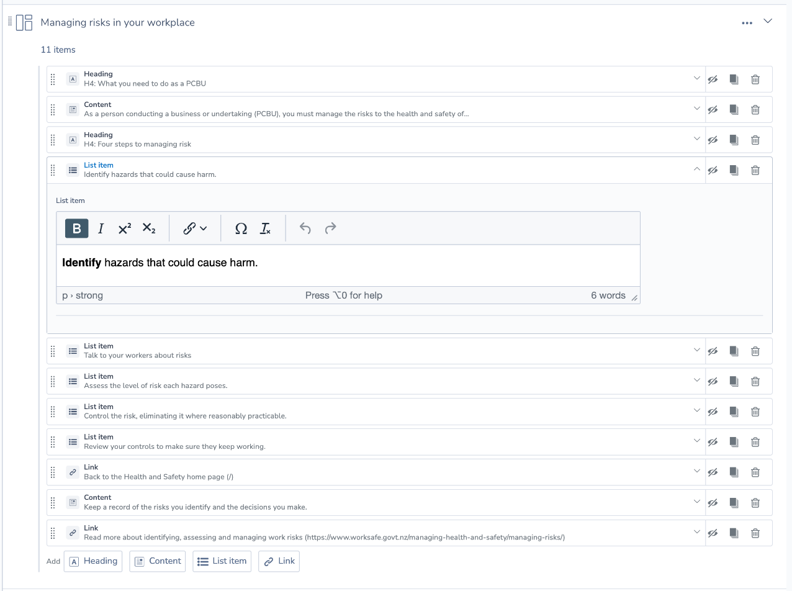

# silverstripe-elemental-nested

[](https://github.com/WPP-Public/silverstripe-elemental-nested/actions/workflows/ci.yml)

Ordered nested items inside Elemental blocks for Silverstripe CMS 6.

## Overview

Apply `HasNestedItems` to any `BaseElement` subclass to manage a sorted list of `NestedItem` records. Nested items are lightweight `DataObject` records (not full blocks): they inherit publish state from the parent, support inline editing in the Elemental editor, and can be reordered, hidden, duplicated, or moved to another compatible parent on the same page.

## Requirements

- PHP 8.3+
- Silverstripe CMS 6
- `dnadesign/silverstripe-elemental` 6

## Installation

```bash
composer require akqa-nz/silverstripe-elemental-nested
```

The CMS editor bundle is committed in `client/dist`. To rebuild it (from this
module directory, with Node 18+):

```bash
npm ci
npm run build
npm test
npm run lint
```

## CMS editor



Blocks with nested items show their items beneath the block in the Elemental
editor. Each item is shown like a compact block (icon, type and summary) and can
be edited inline, dragged to reorder, hidden, duplicated or removed. New items
are added with one button per allowed type.

Like Elemental's own inline forms, nested item forms have no save button of
their own: edits mark the page as changed and are saved when the page is saved.
Editing an item creates a new draft version of its parent block, so changes are
published with the block or page.

The editor extends the standard `ElementEditor` through Injector transforms on
`Element` and `ElementContent`, so nested items move with their parent block.

## Usage

Define nested item classes:

```php
use AKQA\ElementalNested\Models\NestedItem;

class LinkItem extends NestedItem
{
    private static array $db = ['URL' => 'Varchar(2048)'];
}
```

Enable nested items on a block:

```php
use AKQA\ElementalNested\Extensions\HasNestedItems;

class LinkListBlock extends BaseElement
{
    private static array $extensions = [HasNestedItems::class];

    private static array $allowed_nested_items = [LinkItem::class];
}
```

In templates:

```ss
<% loop $Element.getVisibleNestedItems %>
    <% include $ClassName.ShortName %>
<% end_loop %>
```

## Licence

BSD-3-Clause
